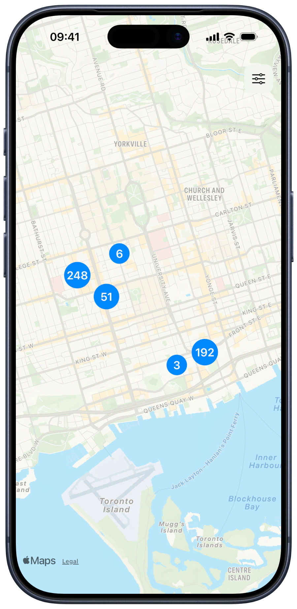
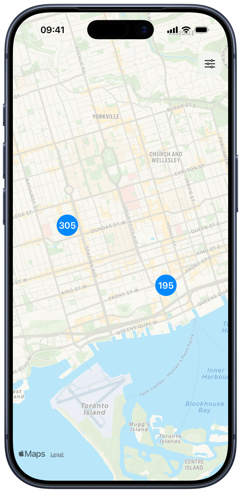
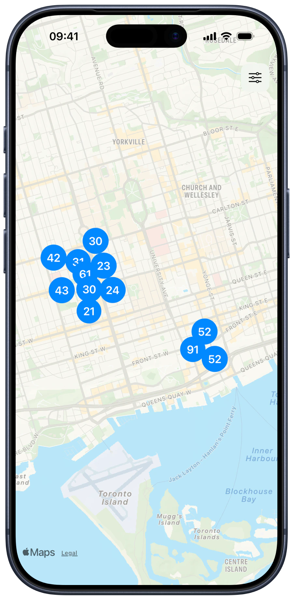

# MapClustering

When you zoom out on a SwiftUI `Map`, nearby pins can overlap and become hard to tap. MapClustering groups them into numbered badges on your existing map. Tap a badge to zoom to its places, and use your own marker and badge views.

**Supercluster → DBSCAN → K-means (`k = 12`)**. Each screenshot shows the same 500 synthetic places in downtown Toronto at the same zoom.

<p align="center">
  <a href="Documentation/Images/toronto-clustering-supercluster.webp"></a>
  <a href="Documentation/Images/toronto-clustering-dbscan.webp"></a>
  <a href="Documentation/Images/toronto-clustering-k-means.webp"></a>
</p>

[See the same map with clustering off](Documentation/Images/toronto-clustering-off.webp).

[Install](#install) · [See the Swift example](#show-clustered-markers) · [Try the Toronto demo](#try-the-toronto-demo)

## Install

Requires Swift 6 and iOS 17+, macOS 14+, or visionOS 1+.

In Xcode, choose **File > Add Package Dependencies** and enter `https://github.com/billycychan/swiftui-map-clustering`. Start at version **0.0.2** and add the **MapClustering** product to your app target. Also add **MapClusteringCore** if your app imports the settings or core types directly.

In a Swift package, add the dependency and products in `Package.swift`:

```swift
// Add to the package dependencies.
.package(url: "https://github.com/billycychan/swiftui-map-clustering", from: "0.0.2"),

// Add to your app target's dependencies.
.product(name: "MapClustering", package: "swiftui-map-clustering"),
.product(name: "MapClusteringCore", package: "swiftui-map-clustering"),
```

## Show clustered markers

Define a place with a stable ID and a coordinate. Keep one controller in view state and pass it to the map content and modifier. This example starts over downtown Toronto with the default Supercluster algorithm and count badge.

```swift
import MapClustering
import MapKit
import SwiftUI

struct PlacesMap: View {
    struct Place: Identifiable {
        let id: Int
        let name: String
        let coordinate: CLLocationCoordinate2D
    }

    private static let samplePlaces = [
        Place(id: 1, name: "Union Station",
              coordinate: CLLocationCoordinate2D(latitude: 43.6453, longitude: -79.3806)),
        Place(id: 2, name: "Scotiabank Arena",
              coordinate: CLLocationCoordinate2D(latitude: 43.6435, longitude: -79.3791))
    ]

    @State private var controller = ClusterController(items: Self.samplePlaces, coordinate: \.coordinate)

    @State private var position = MapCameraPosition.region(MKCoordinateRegion(
        center: CLLocationCoordinate2D(latitude: 43.6453, longitude: -79.3806),
        span: MKCoordinateSpan(latitudeDelta: 0.08, longitudeDelta: 0.08)
    ))

    var body: some View {
        Map(position: $position) {
            ClusteredAnnotations(controller, position: $position) { place in
                Marker(place.name, coordinate: place.coordinate)
            }
        }
        .mapClustering(controller)
    }
}
```

## Settings

| Setting | Default | What it controls |
| --- | --- | --- |
| `algorithm` | `.supercluster()` | Grouping method. Also supports `.dbscan(…)`, `.kMeans(…)`, and `.off`. |
| `radius` | `40` | Search radius in logical tile pixels for Supercluster and DBSCAN. |
| `minimumPointCount` | `2` | Minimum point count for Supercluster and DBSCAN. DBSCAN includes the point itself in its neighborhood. |
| `clusterCount` | Required for K-means | Target number of K-means groups. |
| `minimumClusterSize` | `2` | K-means groups below this size appear as individual pins. |
| `zoomRange` | `0...16` | Reuse the lowest level below the range and show individual pins above the range. Zoom bounds are clamped to `0...30`. |
| `tileExtent` | `512` | Logical tile width used to scale the radius and calculate zoom. |
| `spatialIndexLeafSize` | `64` | Maximum spatial index leaf size for Supercluster and DBSCAN. |
| `frequency` | `.onEnd` | Update after camera movement ends. Use `.continuous` for updates during movement. |
| `onEvent` | `nil` | Optional callback for aggregate timing and count diagnostics. |

Import `MapClusteringCore` when configuring a controller. For example, call this function with the controller from your map:

```swift
import MapClustering
import MapClusteringCore

@MainActor
func configure<Item>(_ controller: ClusterController<Item>) {
    controller.configuration = ClusteringConfiguration(
        algorithm: .supercluster(radius: 60, minimumPointCount: 3),
        zoomRange: 2...18,
        tileExtent: 512,
        spatialIndexLeafSize: 64
    )

    // Set one of these to switch modes while keeping the current camera.
    // controller.configuration.algorithm = .dbscan(radius: 60, minimumPointCount: 4)
    // controller.configuration.algorithm = .kMeans(clusterCount: 8, minimumClusterSize: 3)
    // controller.configuration.algorithm = .off
}
```

For updates while panning or zooming, use `.mapClustering(controller, frequency: .continuous)` on the map. To send diagnostics to unified logging, add the following extension and initialize the map's controller with `Self.makeLoggingController(items: Self.samplePlaces)`.

```swift
import MapClustering
import OSLog

extension PlacesMap {
    @MainActor
    static func makeLoggingController(items: [Place]) -> ClusterController<Place> {
        let logger = Logger(subsystem: "Places", category: "Clustering")
        return ClusterController(items: items, coordinate: \.coordinate, onEvent: { event in
            logger.info("\(event.stage.rawValue, privacy: .public) took \(String(describing: event.elapsed), privacy: .public)")
        })
    }
}
```

## Try the Toronto demo

Open [Examples/Toronto.xcodeproj](Examples/Toronto.xcodeproj), select the shared **Toronto** scheme, and run on iOS or macOS. The map starts with 100 downtown pins. Open **Clustering Debug** to compare algorithms and distributions, adjust settings, and display up to 5,000 pins. Tap or click a cluster to zoom in.

## Read more

- [Integration guide](Documentation/Usage.md) for changing data, selection, custom badges, and camera behavior
- [Device benchmarks](Documentation/Benchmarks.md) for setup, datasets, and recorded timings
- [SwiftUI Map SDK check](Documentation/SDK-Compatibility.md) for the original SDK inspection
- [Changelog](CHANGELOG.md) and [MIT license](LICENSE)
